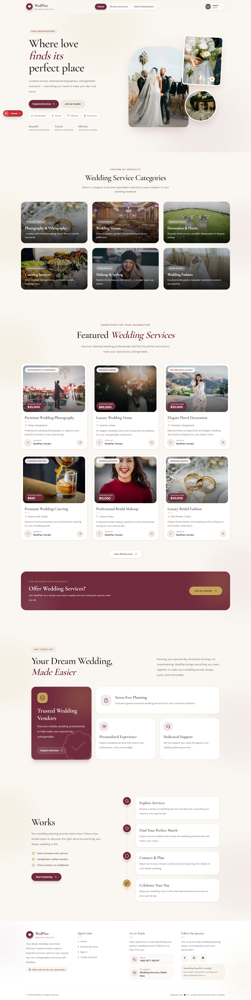

# WedPlan — Wedding Planning Platform

A modern wedding planning platform designed to simplify the process of discovering wedding services, connecting with vendors, and managing bookings in one place.

WedPlan brings customers, vendors, and administrators together through a role-based platform with service management, booking workflows, and premium subscriptions.

<p align="center">
  
</p>

<p align="center">
  <a href="https://wedplan-mehedilabs.vercel.app">Live Website</a> •
  <a href="https://github.com/mehedilabs/wedplan-server">Backend Repository</a>
</p>

---

## Overview

WedPlan provides a centralized platform where customers can explore wedding services and submit booking requests, while vendors can manage their services and respond to customer requests.

Administrators can manage platform users, review services, and monitor transactions.

The application focuses on a clean user experience, role-based dashboards, responsive layouts, and organized service management.

## Key Features

### Authentication & User Management

- Email and password authentication.
- Google authentication.
- Role-based registration for customers and vendors.
- Role-based dashboard access.
- Profile management with profile image support.

### Customer Experience

- Browse available wedding services.
- Explore service details.
- Submit booking requests.
- View and manage bookings.
- Cancel pending booking requests.
- Manage personal profile information.

### Vendor Dashboard

- Dedicated vendor dashboard.
- Create, update, and manage services.
- Track service approval status.
- View customer booking requests.
- Accept or reject booking requests.
- Manage subscription plans.

### Admin Dashboard

- Platform overview.
- Manage users and account status.
- Review and manage submitted services.
- Approve or reject services.
- View transaction information.

### Subscription & Payments

- Premium subscription integration with Stripe.
- Secure payment processing.
- Payment webhook handling.
- Subscription status management.

### User Interface

- Responsive design for mobile, tablet, and desktop.
- Role-specific dashboard layouts.
- Loading and error states.
- Toast notifications for user feedback.
- Custom not-found and error pages.

## Technology Stack

| Category       | Technologies       |
| -------------- | ------------------ |
| Framework      | Next.js            |
| UI Library     | React              |
| Language       | TypeScript         |
| Styling        | Tailwind CSS       |
| UI Components  | shadcn/ui, Base UI |
| Authentication | Better Auth        |
| Database       | MongoDB            |
| Payment        | Stripe             |
| Icons          | Lucide React       |
| Notifications  | Sonner             |
| Deployment     | Vercel             |

## Project Architecture

WedPlan follows a separated frontend and backend architecture.

- **Frontend:** Next.js application responsible for the user interface, authentication experience, dashboards, and API communication.
- **Backend:** Express.js application responsible for API operations, database interactions, booking workflows, service management, and payment processing.
- **Database:** MongoDB stores application data.
- **Authentication:** Better Auth manages user authentication, while the backend verifies authenticated requests.

## Getting Started

### Prerequisites

Make sure you have the following installed:

- Node.js (LTS recommended)
- npm
- MongoDB database
- Google OAuth credentials (if using Google sign-in)
- A running WedPlan backend

### 1. Clone the Repository

```bash
git clone https://github.com/mehedilabs/wedplan-client.git
cd wedplan-client
```

### 2. Install Dependencies

```bash
npm install
```

### 3. Configure Environment Variables

Create a `.env.local` file in the project root.

```env
# Backend API
NEXT_PUBLIC_API_URL=http://localhost:5000

# MongoDB
MONGODB_URI=your_mongodb_connection_string
DB_NAME=your_database_name

# Better Auth
BETTER_AUTH_URL=http://localhost:3000

# Google OAuth
GOOGLE_CLIENT_ID=your_google_client_id
GOOGLE_CLIENT_SECRET=your_google_client_secret
```

Replace the placeholder values with your own credentials. Never commit real environment variables or secret keys.

### 4. Run the Development Server

```bash
npm run dev
```

Open [http://localhost:3000](http://localhost:3000) in your browser.

## Backend Connection

The frontend communicates with the WedPlan Express API.

Make sure the backend is running and `NEXT_PUBLIC_API_URL` points to the correct backend address.

**Backend Repository:**  
https://github.com/mehedilabs/wedplan-server

## Environment Configuration

The following environment variables are used by the frontend:

| Variable               | Purpose                    |
| ---------------------- | -------------------------- |
| `NEXT_PUBLIC_API_URL`  | Backend API base URL       |
| `MONGODB_URI`          | MongoDB connection string  |
| `DB_NAME`              | MongoDB database name      |
| `BETTER_AUTH_URL`      | Better Auth base URL       |
| `GOOGLE_CLIENT_ID`     | Google OAuth client ID     |
| `GOOGLE_CLIENT_SECRET` | Google OAuth client secret |

Keep private credentials on the server and never expose them through public environment variables.

## Deployment

The frontend is deployed on Vercel.

**Live Application:**  
https://wedplan-mehedilabs.vercel.app

For production deployment, configure the required environment variables in the hosting platform and ensure the backend API URL points to the deployed server.

## Related Repository

**Backend:** https://github.com/mehedilabs/wedplan-server

---

<p align="center">
  Built with care for a better wedding planning experience.
</p>
